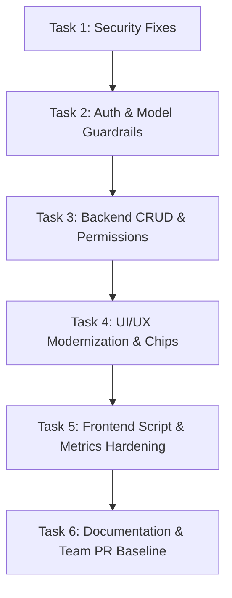

# Product Requirements Document (PRD) — CampusConnect

**Project Name:** CampusConnect  
**Document Version:** 1.0.0  
**Target Loop / Agent Engine:** Ralph Loop / Autonomous Agent Execution  
**Project Reference:** Code2Chill — Weekly Project 01  

---

## 1. Executive Summary & Goals

### 1.1 Overview
CampusConnect is a clean, full-stack, beginner-friendly web application designed for college students to report, track, and resolve common campus issues (facilities, equipment, lost items, and general college problems).

### 1.2 Core Objectives
- Fulfill all project specifications outlined in the Code2Chill Weekly Project 01 assignment.
- Strictly adhere to the prescribed tech stack: **HTML, CSS, JavaScript (Vanilla)** frontend + **Python, FastAPI** backend + **SQLite** database.
- Resolve all identified architectural, usability, and security vulnerabilities without adding unnecessary framework bloat or third-party dependencies.
- Enable autonomous task decomposition for the Ralph agent loop with actionable, verifiable acceptance criteria.

---

## 2. Technology Stack & Constraints

| Layer | Approved Technology | Prohibited |
| :--- | :--- | :--- |
| **Frontend** | Vanilla HTML5, CSS3, ES6+ JavaScript | React, Vue, Angular, TailwindCSS, Bootstrap, Webpack, Vite |
| **Backend** | Python 3.10+, FastAPI, Uvicorn | Django, Flask, Express, heavy ORMs (keep native SQLite / clean queries) |
| **Database** | SQLite3 (Native driver with WAL mode enabled) | PostgreSQL, MongoDB, MySQL |
| **Auth & Security** | JWT (`PyJWT` / `python-jose`), Bcrypt / secure fallback | Third-party auth providers (Firebase, Auth0) |
| **Version Control** | Git & GitHub (PR and branching workflow) | Direct commits to `main` without review standard |

---

## 3. High-Priority Problem Statements & Backlog

### Epic 1: Security & Vulnerability Hardening
1. **CORS Insecurity**: `main.py` uses `allow_origins=["*"]` with `allow_credentials=True`. This is invalid per CORS specifications and insecure.
2. **Hardcoded Fallback Secret**: `SECRET_KEY` falls back to a predictable hardcoded string in `auth.py`.
3. **Broken Object-Level Authorization (BOLA)**: Any logged-in student can modify the status of any issue submitted by anyone else.
4. **Information Disclosure in Exceptions**: Internal SQLite error messages are returned directly to the client in HTTP 500 exceptions.
5. **Wildcard Injection in Search**: Special SQL characters (`%`, `_`) in search inputs are not sanitized before `LIKE` clause binding.

### Epic 2: UX & Visual Refinements
1. **Authentication Flow Deficiencies**: Registration lacks a "Confirm Password" field and show/hide password toggles.
2. **Category Visual Distinction**: Dashboard lacks quick category filter chips and category-specific iconography.
3. **Form Experience**: Description inputs lack character counting and form feedback indicators.
4. **Dashboard Metrics Drift**: Issue count metrics currently fluctuate incorrectly during active client search/filter operations.

### Epic 3: Specification Alignment & Team Workflow
1. **Missing Team Members in README**: Assignment requires explicit team member names and GitHub contribution tracking.
2. **Issue Deletion / Self-Management**: Students cannot retract or edit their own accidentally submitted issues.

---

## 4. Detailed Feature Specifications & Tasks (Ralph Loop Queue)

---

### Task 1: Security & Configuration Hardening
- **Target Files**: `backend/app/main.py`, `backend/app/auth.py`
- **Requirements**:
  - Replace wildcard CORS `allow_origins=["*"]` with an explicit list supporting local development ports:
    `["http://localhost:8000", "http://127.0.0.1:8000", "http://localhost:5500", "http://127.0.0.1:5500", "http://localhost:3000"]` and `allow_origin_regex` for localhost addresses.
  - In `auth.py`, load `SECRET_KEY` from environment variables, and fallback to a dynamically generated runtime secret (with a terminal warning) or local `.env` configuration rather than a static shared string.
  - Sanitize search queries by escaping `%`, `_`, and `\` before querying `LIKE ?`.
  - Replace raw `str(exc)` exposure in HTTP responses with user-safe error messages while logging exception details to stdout.
- **Verification**:
  - Test CORS preflight with credentials from local frontend origin.
  - Verify that invalid login/register/database errors do not leak stack traces or internal table schemas.

---

### Task 2: Auth Flow Enhancements (Password Confirmation & Visibility)
- **Target Files**: `frontend/index.html`, `frontend/js/auth.js`, `frontend/css/style.css`
- **Requirements**:
  - Add "Confirm Password" input to the registration form (`#reg-confirm-password`).
  - Validate that password matches confirm password both client-side and in Pydantic schema validation.
  - Add interactive "Show/Hide Password" toggle buttons (👁️) to password input fields.
  - Maintain clean styling aligned with `--slate-*` and `--primary-*` variables.
- **Verification**:
  - Attempt registration with mismatching passwords; verify user receives an immediate clear error toast.
  - Toggle password visibility; confirm text toggles between `password` and `text`.

---

### Task 3: Issue Ownership & Status Update Authorization
- **Target Files**: `backend/app/main.py`, `backend/app/models.py`, `frontend/issue-detail.html`
- **Requirements**:
  - Update `update_issue_status` endpoint:
    - Validate that the user updating the status is either the author of the issue OR an authorized campus staff/admin (or allow explicit status audit note).
  - Add an optional endpoint `DELETE /api/issues/{id}` allowing students to delete only issues that belong to them (`user_id == current_user.id`).
  - In `issue-detail.html`, conditionally display the "Delete Issue" button only if `currentUser.id === issue.user_id`.
- **Verification**:
  - Log in as Student A; attempt to delete Student B's issue via API; verify HTTP 403 Forbidden.
  - Delete own issue; verify issue is removed from DB and redirected to dashboard.

---

### Task 4: UI/UX Polish — Category Chips, Badges & Counters
- **Target Files**: `frontend/dashboard.html`, `frontend/create-issue.html`, `frontend/css/style.css`
- **Requirements**:
  - **Category Chips**: Above the issues grid in `dashboard.html`, add clickable quick-filter chips for `All`, `Classroom` 🏫, `Campus` 🌳, `Lost & Found` 🎒, and `General` 📋 with active highlight state.
  - **Category Badges**: Style badges with distinct color palettes:
    - Classroom: Indigo / Purple
    - Campus: Emerald / Green
    - Lost & Found: Amber / Orange
    - General: Sky / Blue
  - **Character Counter**: Add a live character counter (`0 / 3000`) beneath the description textarea in `create-issue.html`.
- **Verification**:
  - Clicking category chips filters the cards instantaneously.
  - Typing in the textarea updates the character counter in real-time.

---

### Task 5: Dashboard Metric Counters Consistency Fix
- **Target Files**: `frontend/js/dashboard.js`
- **Requirements**:
  - Decouple the top statistics metrics (`stat-total`, `stat-open`, `stat-progress`, `stat-resolved`) from the filtered search results.
  - Maintain an initial unfiltered fetch or a dedicated lightweight summary query so summary cards always reflect global campus stats while the issue grid reflects the active search/filter.
- **Verification**:
  - Search for a specific query that yields 1 result.
  - Confirm the search grid renders 1 result while the top metrics cards continue showing true campus totals.

---

### Task 6: Repository & GitHub Collaboration Compliance
- **Target Files**: `README.md`
- **Requirements**:
  - Add a dedicated "Team Members & Contributions" table in `README.md` with:
    - Member Name
    - Student ID / Department
    - Assigned Features / Role
    - GitHub Branch Pattern (`feature/<name>-<task>`)
  - Document standard Pull Request checklist matching the PDF's requirement (`Branch -> Commit -> Push -> Pull Request -> Merge`).
- **Verification**:
  - Check that `README.md` renders without placeholder blanks and has concrete instructions for grading evaluation.

---

## 5. Ralph Loop Execution Checklist

| Step | Task Name | Status | Acceptance Criteria |
| :---: | :--- | :---: | :--- |
| **01** | CORS & Security Hardening | `PENDING` | Valid origins whitelist; no wildcard credential clash; search sanitized. |
| **02** | Registration & Password Controls | `PENDING` | Confirm password enforced; toggle eye icons work smoothly. |
| **03** | Authorization & Issue Ownership | `PENDING` | Status updates & deletes restricted; unauthorized actions return 403. |
| **04** | Category Chips & Badge System | `PENDING` | 4 distinct category styles; 1-click filter chips operational. |
| **05** | Dashboard Metrics Stability | `PENDING` | Global metrics stay accurate during filtered search. |
| **06** | Readme & Submission Polish | `PENDING` | Complete team matrix and verification guidelines documented. |

---

## 6. Success Metrics & Definition of Done
1. **0 Console Errors**: Zero JavaScript or CORS errors in the browser console.
2. **100% Spec Adherence**: All pages (`index.html`, `dashboard.html`, `create-issue.html`, `issue-detail.html`, `profile.html`) work out of the box.
3. **Vanilla Purity**: No node_modules, bundlers, or prohibited frameworks introduced.
4. **Security Verified**: Passwords securely hashed, JWTs validated, parameters sanitized, errors scrubbed.
